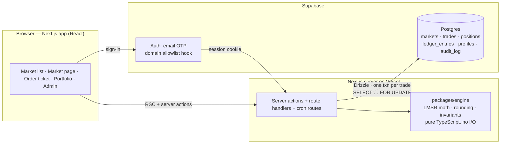

# Architecture — MC-Kalshi (working name)

Status: v0.1, 2026-10-28. Changes to anything decided here go through an ADR (`docs/adr/`).

## 1. What we are building

A web app where Maryville College students, faculty and staff trade YES/NO contracts on
campus events using **points**, not money. The UX follows Kalshi: each market shows a YES
and a NO price from 1 to 99 (read as percent probability), an order ticket ("Buy YES ·
500 points → 9.75 contracts at avg 51 → pays 976 if YES"), a price chart, positions, and a
portfolio. The pricing mechanism is **not** Kalshi's order book; see §5.

### MVP scope
- Sign in with a Maryville College email (one-time code / magic link).
- Browse markets by category; market page with price, chart, rules, close and resolve dates.
- Buy or sell YES/NO against the automated market maker; positions and P&L.
- Starting balance plus weekly stipend; leaderboard.
- Propose a market (anyone); open / close / resolve / void (moderators).
- Resolution with a source link and a 24-hour dispute window.
- Admin: roles, audit log, ledger adjustments with a reason.

### Non-goals for MVP
Real money or prizes; limit orders or an order book; multi-outcome markets; comments and
social features; native mobile apps; accounts outside the college.

## 2. Constraints that shape the design

| Constraint | Consequence |
|---|---|
| Play money only (ADR-0001). Real-money event contracts are CFTC-regulated; unlicensed wagering is illegal in Tennessee; the college conduct code governs gambling. | No payments, KYC, or withdrawals anywhere. Points have no cash value and cannot be bought. |
| Small, thin community (about 1,100 students). | An order book would sit empty; an automated market maker always quotes a price (ADR-0002). |
| Solo developer, zero budget. | Managed free tiers (Vercel + Supabase), one language (TypeScript), few moving parts (ADR-0003). |
| Integrity over speed. | Every point movement is a ledger entry; trades are serialized per market; the engine is pure and property-tested. |
| Student-athletes are bound by NCAA wagering rules. | Even with play money, athletics markets avoid athlete-specific props and get a policy review before launch (§11). |

## 3. System overview



Two hosted pieces (Next.js on Vercel; Postgres + Auth on Supabase) and one pure library.
No queues, workers, or WebSockets in MVP: an open market page polls every 3 s. Supabase
Realtime is a later upgrade behind the same data contract.

## 4. Domain model

```
Category 1─* Market 1─* Trade
                  1─* Position            (one per user per market)
                  1─* PriceSnapshot       (chart)
                  0─* Dispute
User (profile) 1─* Trade · Position · LedgerEntry(account_type = user)
Market 1─* LedgerEntry(account_type = market_pool)
```

**Market**: `title`, `rules` (plain-English resolution criteria), `category`, `close_at`
(trading stops), `resolve_by`, `status`, `outcome`, `b` (liquidity, in contracts), `q_yes`,
`q_no` (AMM state), `created_by`, `resolved_by`, `resolution_source`.

Status machine:
```
proposed ─► open ─► closed ─► resolved(YES|NO) ─► finalized
    └► rejected        └──────► voided   (allowed from open/closed/resolved, never from finalized)
```
- `proposed`: anyone may propose; a moderator edits the rules, sets `b`, then opens it.
- `open`: trading allowed until `close_at`.
- `closed`: no trading; awaiting resolution.
- `resolved`: outcome and source set; payouts credited; 24 h dispute window.
- `finalized`: window passed or dispute decided; immutable.
- `voided`: all trades reversed; each trader refunded exactly their net cost.

**Position**: `contracts_yes`, `contracts_no` (numeric, 6 dp), `cost_basis_points` (integer, signed).
**Trade**: immutable row per fill: `side` (YES|NO), `contracts` (signed: + buy, − sell),
`cost_points` (signed), `prob_before`, `prob_after`, `idempotency_key`.
**LedgerEntry**: append-only, double-entry: `(account_type, account_id, delta_points, reason, ref_type, ref_id)`.
Account types: `user`, `market_pool`, `house`. Reasons: `signup_bonus`, `stipend`, `trade`,
`payout`, `void_refund`, `admin_adjustment`.
**Invariant: SUM(delta_points) over all rows = 0.** `balances(user_id, points)` is a cache
updated in the same transaction and re-checked against the ledger by a scheduled job and in CI.

## 5. Market engine (`packages/engine`)

Mechanism: **Logarithmic Market Scoring Rule (LMSR)**, two outcomes (ADR-0002).

Units: a contract pays **100 points** if it resolves in its favor. Prices display as integers
1–99 (= probability × 100). `b` is in contracts; `q` is the number of contracts the AMM has
sold on each side.

```
C(q_y, q_n)        = 100 · b · ln( e^{q_y/b} + e^{q_n/b} )         cost function, in points
p_yes              = e^{q_y/b} / ( e^{q_y/b} + e^{q_n/b} )           instantaneous probability
cost(buy Δ YES)    = C(q_y + Δ, q_n) − C(q_y, q_n)                 Δ < 0 is a sell (negative cost = proceeds)
contracts for budget c points, buying YES (closed form, no solver):
  Δ = b · ln( e^{c/(100·b)} · (e^{q_y/b} + e^{q_n/b}) − e^{q_n/b} ) − q_y
max pool loss per market = 100 · b · ln 2                         b = 100 → about 6,931 points
```

Implementation rules:
- Compute with log-sum-exp (subtract `max(q)/b` first) to avoid overflow. Store only `q`, never prices.
- The cost of one trade is not `C(after) − C(before)` (that cancels catastrophically for micro-trades
  and for sells at prices within a few ulps of 1). It is `100·b·ln(p_other + p_side·e^{Δ/b})` with
  `p_other` taken from its own exponential, never as `1 − p`; implemented as `log1p(p_side·expm1(Δ/b))`
  for `|Δ| ≤ b`, and beyond that as `logAddExp(ln p_other, ln p_side + Δ/b)`, which adds two positive
  terms (no cancellation) and cannot overflow (`tradeCost`).
- Budget inversion in the same spirit: `Δ = b·log1p(expm1(c/(100·b)) / p_side)`, floored to 6 dp and
  capped at the room left under `MAX_CONTRACTS`, then fitted on integer micro-contracts: a bisection
  (at most 64 quotes) when that amount overshoots the budget, up to four forward probes when it
  fits, so the result is the largest grid amount whose rounded cost is within the budget.
- Trade cost and budget inversion are computed in the log domain (`ln p_yes` and `ln p_no` stay
  finite for every finite `q`), so a side whose probability has underflowed to 0 still prices
  finitely: a huge buy of it costs about nothing (one point after rounding) and a huge sell of the
  certain side returns 100 points per contract.
- In double precision `p_yes` reaches exactly 1 once `(q_y − q_n)/b` exceeds about 36.7 (ln 2⁵³) and
  exactly 0 below about −745; quoting and budget inversion still work there (log domain, above).
- **Rounding always favors the pool**: a buy's cost rounds **up** to a whole point; a sell's
  proceeds round **down**; payouts round **down** (computed in micro-contract integers,
  `floor(round(contracts·1e6) / 1e4)`, so large amounts do not misround). Contracts are kept to 6 dp. Point values
  carry a tolerance of `min(1e-6, max(1e-12, 1e-12·|x|))` before rounding so floating-point noise cannot move a
  whole-point boundary; a buy never costs less than one point.
- Bounds: `|q_y|`, `|q_n|` and a trade's `|Δ|` are at most 1e9 contracts (`MAX_CONTRACTS`), budgets and
  cost bases at most 1e12 points (`MAX_POINTS`), so every integer result stays a safe integer; `q`
  must sit on the six-decimal grid. A budget that would buy more than 1e9 contracts, or push the side's `q`
  beyond it, is rejected unless the capped fill still costs the whole budget.
- Precision limits, accepted and recorded in the M1 spec: invariant 4 holds in exact arithmetic, and
  noise of up to ~3e-5 points per trade could exceed it by a fraction of a point only on an
  engineered path needing a ~1e11-point bankroll; above ~1.7e10 points the rounding tolerance is
  below one ulp, so an exact-integer cost can be charged one extra point (favors the pool);
  `Math.exp`/`log1p`/`expm1` differ across JavaScript engines, so browser quotes are indicative and
  the server's fill is authoritative (§9); an underflowed side prices every trade up to ~700·b at
  exactly 0, so strict monotonicity holds only inside the representable range.
- One function produces both the quote shown in the ticket and the fill executed server-side:
  `{ contracts, costPoints, avgPrice, probBefore, probAfter, payoutIfWin }`. The server
  rejects a fill whose price moved beyond the user's slippage tolerance (default 2 points).
- Default `b = 100`; moderators may set 50–500 per market.

Properties the test suite asserts (Vitest + fast-check):
1. `p_yes + p_no = 1` and `0 ≤ p ≤ 1` for all finite `q`; strictly `0 < p < 1` while `|q_y − q_n|/b < 36`.
2. `cost(0) = 0`; cost is strictly increasing and convex in Δ.
3. Buy then sell the same Δ never returns more than was paid (after rounding).
4. Pool liability never exceeds `100·b·ln 2` under any random trade sequence.
5. Budget inversion: `cost(contractsFor(c)) ≤ c` and within 1 point of `c`.
6. Void: reversing every trade returns each user exactly to their pre-market balance.

Worked example: `b = 100`, fresh market `q = (0, 0)`, `p = 0.50`. Spend 500 points on YES:
`Δ = 100 · ln(2·e^{0.05} − 1) ≈ 9.7619` contracts, avg price 51, new `p_yes ≈ 0.5244`,
payout if YES = 976 points (the engine's property suite pins these numbers).

## 6. Key flows

**Sign-in.** Email one-time code via Supabase Auth. A server-side `before-user-created`
auth hook rejects any address not ending in `@maryvillecollege.edu` or
`@my.maryvillecollege.edu` (students use the `my.` subdomain). First sign-in creates the
`profiles` row and posts the `signup_bonus` ledger entry.

**Trade.** Server action `placeTrade({ marketId, side, points | contracts, maxSlippage, idempotencyKey })`:
1. `BEGIN`; `SELECT … FROM markets WHERE id = $1 FOR UPDATE` (serializes trades per market).
2. Reject unless `status = 'open'` and `now() < close_at`.
3. Engine quote from current `q`; check slippage; check `balances.points ≥ cost`.
4. Insert `trades`; upsert `positions`; update `markets.q_*`; insert two `ledger_entries`
   (user −cost, market_pool +cost); update `balances`; insert `price_snapshots`. `COMMIT`.
5. A duplicate `idempotency_key` returns the original trade (safe retries).

**Close.** A cron route (every minute) flips `open → closed` where `close_at` has passed.
`placeTrade` also checks `close_at`, so the cron is a convenience, not the guard.

**Resolve.** Moderator action with `outcome` and `resolution_source`. In one transaction:
set status and credit each position `winning_contracts × 100` points (`payout`, from
`market_pool` to `user`); the `house` account absorbs the pool's shortfall or surplus so the
ledger still sums to zero. 24 h dispute window; a dispute goes to an admin decision; then
`finalized`.

**Void.** Refund each user their net `cost_basis_points` (`void_refund`), zero positions,
status `voided`. For ambiguous rules or cancelled events.

## 7. Data model (Postgres via Drizzle)

| Table | Key columns | Notes |
|---|---|---|
| `profiles` | `id` (= `auth.users.id`), `email`, `display_name`, `role` (member / moderator / admin), `suspended_at`, `leaderboard_opt_out`, `created_at` | Created on first sign-in; suspension and removal rules in SOP-08 |
| `settings` | `key`, `value`, `updated_by`, `updated_at` | Economy knobs: signup bonus, weekly stipend, balance cap, default `b` (SOP-08 §5); env vars until M5 |
| `balances` | `user_id`, `points` | Cache; must equal the ledger sum |
| `categories` | `id`, `slug`, `name` | Athletics, Campus Life, Academics, Weather, … |
| `markets` | §4 columns plus `slug`, `created_at`, `opened_at`, `closed_at`, `resolved_at`, `finalized_at` | `CHECK` on status; index `(status, close_at)` |
| `trades` | `id`, `market_id`, `user_id`, `side`, `contracts`, `cost_points`, `prob_before`, `prob_after`, `idempotency_key`, `created_at` | Immutable; unique `(user_id, idempotency_key)` |
| `positions` | `market_id`, `user_id`, `contracts_yes`, `contracts_no`, `cost_basis_points` | PK `(market_id, user_id)` |
| `ledger_entries` | `id`, `account_type`, `account_id`, `delta_points`, `reason`, `ref_type`, `ref_id`, `created_at` | Append-only: app role has no UPDATE/DELETE grant |
| `disputes` | `id`, `market_id`, `user_id`, `reason`, `status`, `decided_by`, `decision_note` | |
| `audit_log` | `id`, `actor_id`, `action`, `target_type`, `target_id`, `payload`, `created_at` | Every moderator/admin action |
| `price_snapshots` | `market_id`, `at`, `prob_yes` | Written on every trade; feeds the chart |

Proposals are `markets` rows with `status = 'proposed'` (no separate table). All data access
goes through the Next.js server with one DB role; Supabase Auth is identity only. Row Level
Security is on with deny-all policies so the public anon key can never read tables directly.

## 8. Tech stack (rationale in ADR-0003)
- **Monorepo** (npm workspaces): `apps/web` (Next.js App Router, React, TypeScript, Tailwind, shadcn/ui) and `packages/engine` (pure TS, zero runtime deps).
- **Data**: Supabase Postgres; Drizzle ORM; `drizzle-kit` migrations committed to git.
- **Auth**: Supabase Auth email OTP; domain allowlist in an auth hook.
- **Tests**: Vitest + fast-check for engine and server actions; Playwright smoke test for the trade loop.
- **Quality**: TypeScript `strict`; Biome (lint + format); GitHub Actions (lint, typecheck, test, build).
- **Hosting**: Vercel (preview per PR, production from `main`); Supabase projects `dev` and `prod`.
- **Observability**: Vercel logs now; Sentry free tier after beta.

## 9. Security and integrity checklist
- Domain allowlist enforced at the auth layer, not the UI.
- No client-trusted numbers: the client sends intent (side, amount, slippage); the server recomputes everything.
- Per-market `FOR UPDATE` lock; idempotency keys; `CHECK` constraints on status transitions.
- Ledger append-only at the grant level; scheduled invariant job (`SUM = 0`, `balances = ledger`).
- Rate limits: trades per user per minute, proposals per user per day.
- Moderator/admin actions check the role server-side and write `audit_log`.
- Secrets only in Vercel/Supabase env; `.env.local` gitignored; `.env.example` documents every variable.

## 10. Environments

| Env | Web | DB / Auth | Purpose |
|---|---|---|---|
| local | `npm run dev` | Supabase `dev` project (or Supabase CLI local stack) | daily work |
| preview | Vercel preview URL per PR | Supabase `dev` | review |
| prod | Vercel production | Supabase `prod` | beta users |

## 11. Open questions (owner: project lead)
1. Confirm with Student Affairs and Athletics compliance that a play-money market on campus events is acceptable, and whether athletics-outcome markets are excluded at launch.
2. Does the college run Google Workspace or Microsoft 365? If so, SSO can replace OTP later (new ADR).
3. Stipend size and cadence. Proposal: 10,000 points at sign-up, +1,000 weekly, balance cap 50,000.
4. Who moderates besides the developer? Minimum two moderators before public beta.
